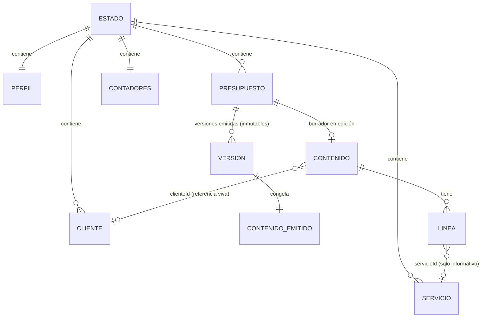
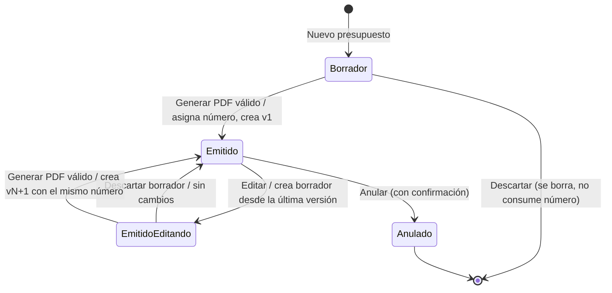

# Data Model — PresupuestoPro v1

**Fase 1 del plan** · Spec: [spec.md](./spec.md) · Decisiones: [research.md](./research.md)

Todo el estado de la aplicación es **un único documento** guardado en el navegador (IndexedDB, clave `presupuestopro:estado`, ver research D4). Ese mismo documento es el contenido de la copia de seguridad ([contracts/copia-de-seguridad.md](./contracts/copia-de-seguridad.md)).

## Convenciones

| Concepto | Representación | Ejemplo |
|---|---|---|
| Dinero | Entero en **céntimos** | `127200` = 1.272,00 € |
| Cantidad | Entero en **centésimas** (máx. 2 decimales) | `250` = 2,5 |
| Porcentaje IRPF | Entero: `15`, `7` o `0` | `15` |
| Fecha | Texto ISO `AAAA-MM-DD` | `2026-10-03` |
| Fecha y hora | Texto ISO 8601 | `2026-10-03T17:51:01.000Z` |
| Identificador | Texto aleatorio (`crypto.randomUUID()`) | `"7f3c…"` |

En pantalla y en el PDF los importes se muestran con formato es-ES (`1.272,00 €`) y las fechas como `dd/mm/aaaa` (FR-027).

## Diagrama



---

## Estado (raíz)

| Campo | Tipo | Notas |
|---|---|---|
| `versionEsquema` | entero | `1`. Permite migraciones futuras. |
| `perfil` | Perfil \| `null` | `null` hasta que se rellena por primera vez. |
| `clientes` | Cliente[] | |
| `catalogo` | Servicio[] | |
| `presupuestos` | Presupuesto[] | |
| `contadores` | `{ [año: string]: entero }` | Último secuencial emitido por año. Ej.: `{ "2026": 42 }`. |
| `tema` | `"claro"` \| `"oscuro"` | FR-026. Por defecto `"claro"`. |

## Perfil del freelancer (FR-001)

| Campo | Tipo | Obligatorio | Validación |
|---|---|---|---|
| `nombre` | texto | Sí, para emitir | No vacío (tras recortar espacios). |
| `nif` | texto | Sí, para emitir | Aviso no bloqueante si no es DNI/NIE/CIF válido (FR-006, research D9). |
| `email` | texto | No | Formato email; aviso si no es válido. |
| `telefono` | texto | No | |
| `direccion` | texto multilínea | No | |
| `logo` | data URL \| `null` | No | Solo PNG o JPG, ≤ 1 MB **antes** de codificar. Si no cumple → se rechaza con aviso y queda `null`. |
| `nuevoAutonomo` | booleano | — | Por defecto `false`. |
| `datosPago` | texto multilínea | No | Texto libre (p. ej. IBAN). |
| `condicionesPorDefecto` | texto multilínea | No | |
| `diasValidezPorDefecto` | entero ≥ 1 | — | Por defecto `30`. |

## Cliente (FR-006)

| Campo | Tipo | Obligatorio | Validación |
|---|---|---|---|
| `id` | texto | Sí | Único. |
| `nombre` | texto | Sí | No vacío. |
| `nif` | texto | No | Aviso no bloqueante si se rellena y no es válido. |
| `tipo` | `"particular"` \| `"empresa"` | Sí | `"empresa"` = Empresa/Autónomo. |
| `email` | texto | No | |
| `direccion` | texto multilínea | No | |

**Borrado**: si algún presupuesto tiene un **borrador** con `clienteId` igual a este cliente, se pide confirmación indicando cuántos ("2 borradores usan este cliente"). Al confirmar, se elimina y esos borradores pasan a `clienteId: null`. Las versiones emitidas no se tocan porque guardan su propia copia (FR-007).

## Servicio del catálogo (FR-003)

| Campo | Tipo | Obligatorio | Validación |
|---|---|---|---|
| `id` | texto | Sí | Único. |
| `descripcion` | texto | Sí | No vacío. |
| `precioCentimos` | entero | Sí | ≥ 0, máx. 2 decimales al introducirlo. |
| `mercadoMinCentimos` | entero \| `null` | No | Si existen ambos: mín ≤ máx; si no, no se guarda y se avisa (US4.4). |
| `mercadoMaxCentimos` | entero \| `null` | No | |

## Presupuesto

Un presupuesto agrupa su **número** y su **historial de versiones**. Lo que se edita es siempre un **borrador** (`borrador`); lo que se emite queda congelado en `versiones`.

| Campo | Tipo | Notas |
|---|---|---|
| `id` | texto | Único. |
| `estado` | `"borrador"` \| `"emitido"` \| `"anulado"` | Ver transiciones. |
| `numero` | texto \| `null` | `"PRE-2026-0042"`. `null` hasta la primera emisión. Nunca cambia después. |
| `anio` | entero \| `null` | Año de la **primera** emisión. |
| `secuencial` | entero \| `null` | |
| `mesEmision` | entero 1–12 \| `null` | Mes de la **primera** emisión; es el que usa el filtro del historial (FR-022). |
| `versiones` | Versión[] | Vacío mientras no se ha emitido nunca. Solo se añaden; nunca se modifican ni se borran. |
| `borrador` | Contenido \| `null` | Contenido en edición. `null` si no hay edición en curso. |
| `creadoEn` | fecha y hora | |
| `anuladoEn` | fecha y hora \| `null` | |

### Contenido (borrador en edición)

| Campo | Tipo | Notas |
|---|---|---|
| `clienteId` | texto \| `null` | Referencia viva a la agenda. `null` si no hay cliente o si se borró. |
| `lineas` | Línea[] | Orden = orden mostrado (FR-008: reordenables). |
| `irpfPct` | `15` \| `7` \| `0` | Propuesto por FR-011; forzado a `0` si el cliente es particular (FR-012). |
| `condiciones` | texto | Se rellena con `perfil.condicionesPorDefecto` al crear (FR-013). |
| `fechaValidezManual` | fecha \| `null` | Si es `null`, la validez es *fecha de emisión + `perfil.diasValidezPorDefecto`*. Si el freelancer la cambia, se guarda aquí. |

### Línea

| Campo | Tipo | Notas |
|---|---|---|
| `id` | texto | |
| `descripcion` | texto | Obligatoria para emitir. |
| `cantidadCentesimas` | entero | Puede ser ≤ 0 en borrador; impide emitir (Edge Cases). |
| `precioCentimos` | entero | Ídem. |
| `servicioId` | texto \| `null` | Servicio de origen (solo informativo; FR-005). |
| `mercadoMinCentimos` / `mercadoMaxCentimos` | entero \| `null` | **Copiados** del servicio al añadir la línea, para seguir mostrando el rango aunque el servicio se borre (US4.3). |

El **subtotal** no se guarda en el borrador: se calcula siempre (FR-009).

### Versión (emitida, inmutable)

| Campo | Tipo | Notas |
|---|---|---|
| `numeroVersion` | entero ≥ 1 | |
| `emitidaEn` | fecha y hora | Fecha de emisión de esta versión (aparece en su PDF). |
| `fechaValidez` | fecha | Ya resuelta (manual o calculada). |
| `emisor` | copia del Perfil (sin `condicionesPorDefecto` ni `diasValidezPorDefecto`) | FR-007. Incluye logo. |
| `cliente` | copia del Cliente (sin `id`) | FR-007. |
| `lineas` | `{ descripcion, cantidadCentesimas, precioCentimos, subtotalCentimos }[]` | Con subtotal ya calculado. |
| `irpfPct` | entero | |
| `condiciones` | texto | |
| `totales` | `{ baseCentimos, ivaCentimos, irpfCentimos, totalCentimos }` | Guardados tal cual se mostraron (FR-023, US6.8). |

---

## Reglas de cálculo (módulo `calculo`)

Entrada: líneas e `irpfPct`. Salida: subtotales y `totales`. Es la **única** fuente de cifras para la pantalla, la vista previa y el PDF (FR-018).

```text
redondearHalfUp(x / 100)  = signo(x) × floor((|x| + 50) / 100)       // x entero
subtotal  = redondearHalfUp(cantidadCentesimas × precioCentimos / 100)
base      = Σ subtotal
iva       = redondearHalfUp(base × 21 / 100)
irpf      = redondearHalfUp(base × irpfPct / 100)
total     = base + iva − irpf
```

Ejemplo de comprobación: 2,5 × 33,33 € → `250 × 3333 = 833250` → `8332,5` → **8333 céntimos = 83,33 €**.

## Retención por defecto (FR-011 / FR-012)

| Tipo de cliente | Perfil "Nuevo autónomo" | `irpfPct` propuesto | ¿Editable? |
|---|---|---|---|
| Particular | cualquiera | 0 | No (se fuerza 0 y se avisa) |
| Empresa/Autónomo | no | 15 | Sí: 15 / 7 / 0 |
| Empresa/Autónomo | sí | 7 | Sí: 15 / 7 / 0 |
| Sin cliente | — | se conserva el valor actual | Sí |

Se recalcula la propuesta **al cambiar de cliente**. Un cambio manual se respeta mientras no se cambie de cliente.

---

## Ciclo de vida del presupuesto (FR-020, FR-021)



`EmitidoEditando` no es un estado nuevo: es `estado = "emitido"` con `borrador ≠ null`.

| Acción | Borrador | Emitido | Anulado |
|---|---|---|---|
| Editar | Sí | Sí (abre borrador de nueva versión) | **No** |
| Generar PDF | Sí, si pasa la validación | Sí, desde el borrador de nueva versión | — |
| Volver a descargar PDF | — | Cualquier versión | Cualquier versión, con marca de agua "ANULADO" |
| Descartar / borrar | Sí (se elimina) | Solo el borrador de nueva versión | No |
| Anular | — | Sí | — |
| Deshacer anulación | — | — | **No** |

### Validación al emitir (FR-014, US2.5, US2.6, US3.4)

Bloquea la emisión (se resaltan todos los problemas a la vez):

1. Perfil sin `nombre` o sin `nif`.
2. Sin cliente (`clienteId` nulo o cliente inexistente).
3. Ninguna línea.
4. Alguna línea sin descripción.
5. Alguna línea con subtotal ≤ 0.

No bloquea (solo avisa): NIF/CIF con formato o letra de control no válidos.

### Numeración (Reglas de numeración, FR-015)

Al emitir **por primera vez**, dentro de una única operación atómica sobre el almacenamiento (research D5):

```text
año        = año de la fecha actual
secuencial = (contadores[año] ?? 0) + 1
contadores[año] = secuencial
numero     = "PRE-" + año + "-" + secuencial con ceros a la izquierda hasta 4 dígitos
             (si supera 9999 se muestra completo: PRE-2026-10000)
```

Las nuevas versiones **no** tocan los contadores. Al importar una copia de seguridad se restauran los contadores tal cual (US8.2).

### Nombre del archivo PDF (FR-016)

`{numero}_{NombreCliente}.pdf`, y `{numero}_{NombreCliente}_v{N}.pdf` desde la versión 2. Ver [contracts/documento-pdf.md](./contracts/documento-pdf.md) para la normalización del nombre del cliente.
