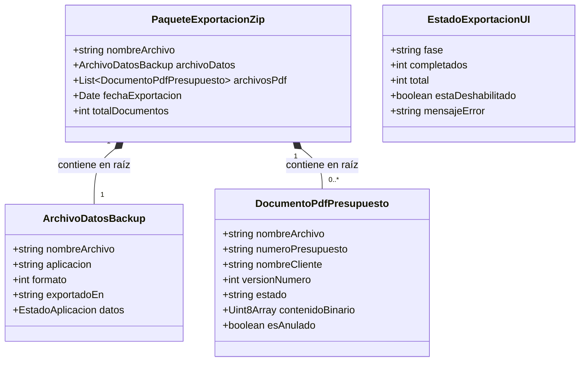
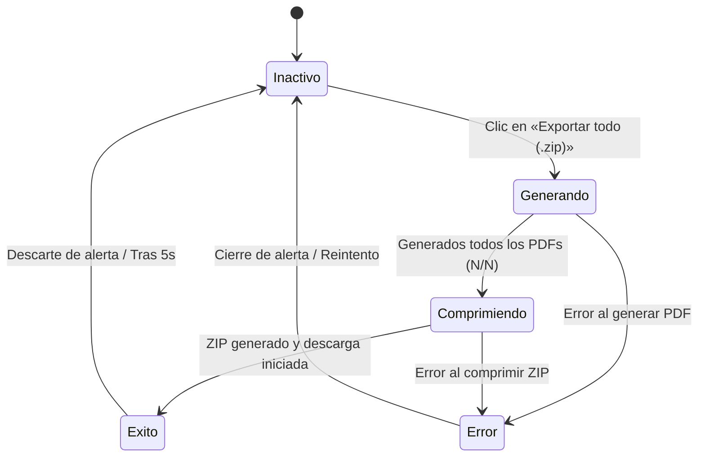

# Data Model: Exportar todos mis presupuestos en un archivo comprimido .zip

**Feature**: `003-exportar-todo-zip`  
**Fecha**: 2026-10-06  
**Estado**: Especificación de Modelo de Datos y Entidades

Este documento describe el modelo de datos, entidades, relaciones y reglas de validación involucradas en el proceso de empaquetado, exportación y respaldo masivo en formato ZIP.

---

## 1. Entidades del Dominio

---

## 2. Descripción de Entidades

### 2.1. PaqueteExportacionZip (Contenedor ZIP)
Representa el archivo binario final `.zip` descargado por el usuario en su navegador.

- **Nombre de archivo (`nombreArchivo`)**: Cadena de texto generada con el patrón `presupuestospro-copia-AAAA-MM-DD.zip` (FR-004), donde `AAAA-MM-DD` es la fecha local del dispositivo del usuario.
- **Estructura interna**: Raíz plana (sin subcarpetas).
- **Contenido**:
  - Exactamente 1 archivo `datos.json`.
  - N archivos `.pdf` (uno por cada presupuesto con número oficial consolidado).
- **Propiedades físicas**:
  - Tipo MIME: `application/zip`
  - Compatibilidad: Descompresión nativa garantizada en Windows Explorer, macOS Archive Utility y Linux unzip.

### 2.2. ArchivoDatosBackup (`datos.json`)
Copia de seguridad integral e inmutable de la base de datos de PresupuestoPro.

- **Nombre en el ZIP**: Exactamente `datos.json` (FR-009).
- **Codificación**: UTF-8 con sangría de 2 espacios (FR-011).
- **Campos del envoltorio**:
  - `aplicacion`: Valor constante `"PresupuestoPro"`.
  - `formato`: Número entero `1` (versión del esquema de respaldo).
  - `exportadoEn`: Marca temporal ISO 8601 UTC al momento de la exportación (ej. `"2026-10-06T19:30:00.000Z"`).
  - `datos`: Objeto íntegro con el estado persistido de la aplicación:
    - `perfil`: Información del emisor profesional y logotipo en Base64.
    - `clientes`: Array de clientes registrados.
    - `catalogo`: Array de conceptos/servicios del catálogo.
    - `contadores`: Objeto con los contadores de correlativos por año (ej. `{ "2026": 12 }`).
    - `presupuestos`: Historial completo de presupuestos (incluyendo borradores, emitidos, versiones históricas y anulados).
- **Validación**: Debe superar con éxito `validarEsquemaCopiaSeguridad()` (SC-008).

### 2.3. DocumentoPdfPresupuesto (PDF individual en lote)
Representación documental compilada de cada presupuesto listo para archivar o imprimir.

- **Criterio de inclusión**: Presupuestos con número oficial asignado y al menos una versión emitida (estados `emitido`, `enviado`, `aceptado`, `rechazado`, `caducado`, `anulado`). Se excluyen los borradores sin numerar (`borrador`).
- **Versión utilizada**: La versión activa más reciente (`versiones[versiones.length - 1]`).
- **Regla de marca de agua**: Si el presupuesto está en estado `anulado`, el PDF incorpora la marca de agua «ANULADO» en color rojo con opacidad al 25% (FR-008).
- **Nombre de archivo (`nombreArchivo`)**:
  - Patrón: `{Número} - {Cliente}.pdf` (FR-006).
  - Saneamiento de `{Cliente}`:
    1. Eliminación de caracteres prohibidos en sistemas de archivos: `[\\/:*?"<>|]` y caracteres de control `[\x00-\x1F\x7F]`.
    2. Colapso de múltiples espacios en blanco a un único espacio.
    3. Truncado a máximo 60 caracteres.
    4. Valor por defecto si queda vacío: `"Cliente"`.
  - Desambiguación ante colisiones: Si dos presupuestos arrojan el mismo nombre de archivo, se añade un sufijo diferenciador correlativo (ej. `{Número} - {Cliente}_2.pdf`).

### 2.4. EstadoExportacionUI (Estado reactivo del proceso)
Modelo transitorio que gestiona el feedback visual en la interfaz durante la exportación.

- **Fases (`fase`)**:
  - `'inactivo'`: Botón habilitado o deshabilitado según presencia de presupuestos exportables.
  - `'generando'`: Generando documentos PDF uno a uno.
  - `'comprimiendo'`: Creando el archivo ZIP con `fflate`.
  - `'exito'`: Operación completada satisfactoriamente (muestra mensaje de confirmación).
  - `'error'`: Fallo durante la generación (muestra alerta en español y restaura interactividad).
- **Contadores de avance**:
  - `completados`: Entero (número de PDFs generados hasta el momento).
  - `total`: Entero (total de presupuestos a generar en PDF).
- **Texto dinámico del botón**:
  - `'inactivo'`: `"Exportar todo (.zip)"`
  - `'generando'`: `"Generando (${completados}/${total})..."`
  - `'comprimiendo'`: `"Comprimiendo ZIP..."`

---

## 3. Transiciones de Estado del Flujo de Exportación

---

## 4. Invariantes y Reglas de Negocio

1. **Solo lectura estricta (FR-012, SC-007)**: La ejecución de la exportación no altera ningún dato en IndexedDB, no incrementa contadores, no cambia estados ni añade marcas temporales a los presupuestos.
2. **Independencia de filtros visuales (FR-003)**: El lote se alimenta directamente de `estado.presupuestos`, ignorando `filtroEstado`, `filtroAnio` y `filtroMes`.
3. **Exactitud decimal y fiscal (FR-007, SC-003)**: Los totales, bases imponibles, porcentajes y cuotas de IVA/IRPF del PDF se calculan con aritmética de céntimos enteros usando la misma definición de documento que la vista previa y descarga individual.
4. **Preservación de borradores (FR-010, A-002)**: Los presupuestos en borrador no generan PDF en el ZIP, pero se incluyen íntegros con sus líneas y datos dentro de `datos.json`.
