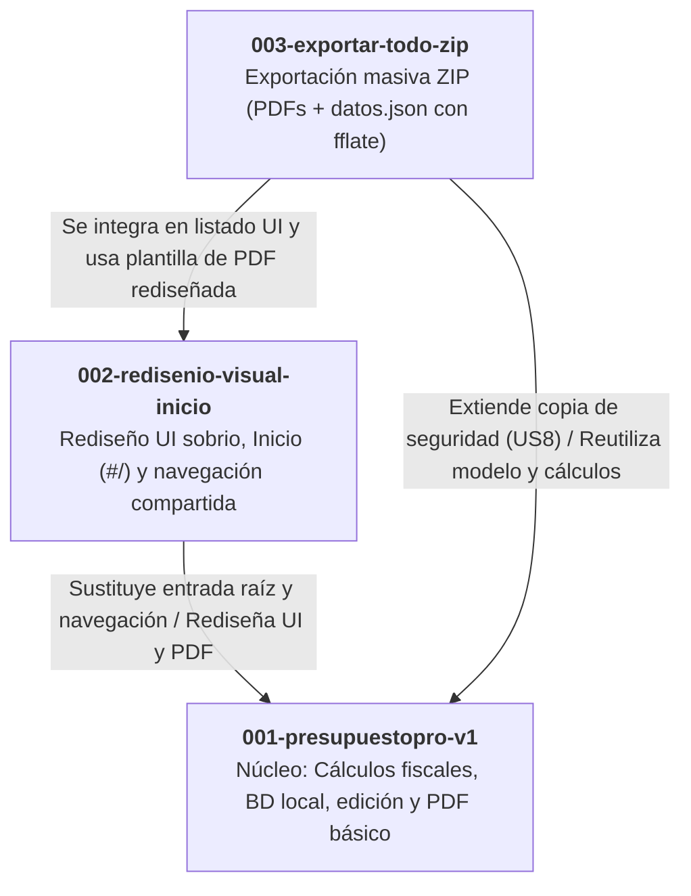

# Registro de Especificaciones de PresupuestoPro

Este documento centraliza el estado, alcance y trazabilidad de todas las especificaciones funcionales y técnicas del proyecto PresupuestoPro, en alineación con la constitución (`.specify/memory/constitution.md`) y la memoria técnica (`AGENTS.md`).

---

## 1. Tabla General de Especificaciones

| Número | Nombre / Feature | Qué aporta | Estado y Rama | Relaciones y Modificaciones cruzadas |
| :---: | :--- | :--- | :--- | :--- |
| **001** | `001-presupuestopro-v1` | **Núcleo fundacional (V1)**: • Creación y edición de presupuestos con cálculo fiscal español exacto en céntimos (Base, IVA 21%, IRPF 15%/7% con detección autónomo nuevo/particular). • Vista previa interactiva y generación de PDF descargable con marca (`pdfmake`). • Perfil del profesional (datos fiscales, logo, condiciones). • Catálogo de servicios con rangos de mercado orientativos. • Agenda de clientes locales. • Histórico, filtros por fecha, numeración correlativa `PRE-{YYYY}-{NNNN}`, versionado (`v1`, `v2`...) y anulación. • Respaldo y restauración local en JSON (US8). | **Publicada / Implementada** Rama: Integrada en `master` (rama `001-presupuestopro-v1` eliminada tras merge). | • **Modificada por 002**: La página de inicio y la navegación global de 002 sustituyen el punto de entrada directo; el sistema visual de 002 redefine colores, tipografías e insignias de estado, y moderniza la plantilla del PDF. • **Modificada/Extendida por 003**: La copia de seguridad local (US8) se amplía con la exportación en lote en archivo comprimido `.zip` que empaqueta todos los PDFs oficiales sanitizados junto a `datos.json`. |
| **002** | `002-redisenio-visual-inicio` | **Experiencia de usuario y sistema visual**: • Página de Inicio (Dashboard / Cuadro de mando en `#/`) con resumen cuantitativo de actividad (conteo total y desglose por 5 estados: Borrador, Enviado, Aceptado, Rechazado, Caducado) y accesos rápidos. • Barra de navegación compartida y persistente en todas las vistas con marcado de sección activa. • Sistema de diseño sobrio y profesional unificado mediante CSS Custom Properties (`public/css/estilos.css`). • Distintivos visuales (*badges*) semánticos para cada estado. • Nueva plantilla estética de PDF coherente con el rediseño web. • Mantenimiento íntegro de la lógica de negocio y datos de 001. | **Publicada / Implementada** Rama: Integrada en `master` (rama `002-redisenio-visual-inicio` eliminada tras merge). | • **Modifica/Sustituye elementos de 001**: Sustituye la vista inicial por defecto por la vista de Inicio (`#/`); sustituye la navegación entre pantallas aisladas por la barra común persistente; reemplaza el sistema de estilos y tema previo por la paleta sobria centralizada; actualiza la plantilla de maquetación del PDF de 001 sin alterar su esquema de datos ni lógica fiscal. |
| **003** | `003-exportar-todo-zip` | **Seguro de vida local y empaquetado masivo**: • Botón «Exportar todo (.zip)» en la cabecera del listado de presupuestos. • Generación 100% en cliente con `fflate` de un archivo comprimido `presupuestospro-copia-AAAA-MM-DD.zip` con estructura plana en la raíz. • Incluye un PDF por cada presupuesto consolidado (estados emitido, enviado, aceptado, rechazado, caducado, anulado) nombrado `{Número} - {Cliente}.pdf`, sanitizando caracteres prohibidos de sistemas de archivos, truncando a 60 caracteres y resolviendo colisiones con sufijo `_${i}`. • Incluye volcado completo `datos.json` con perfil, catálogo, clientes y presupuestos (incluidos borradores). • Control de estados: botón deshabilitado con mensaje informativo cuando hay 0 presupuestos emitidos; indicador dinámico de avance («Generando (X/N)...», «Comprimiendo ZIP...»). • Proceso de solo lectura que preserva los datos intactos. | **Publicada / Implementada** Rama: Integrada en `master` vía merge `--no-ff` (commit `c6bbd60`, rama `003-exportar-todo-zip` eliminada tras cierre). | • **Modifica/Amplía funcionalidad de 001**: Expande la capacidad de copia de seguridad local (US8 de 001, que solo contemplaba descarga/subida de JSON), permitiendo al usuario archivar de una sola vez todos los entregables documentales PDF consolidados junto al volcado `datos.json`. • **Se integra sobre 002**: Incorpora el botón de acción en la cabecera del listado rediseñado en 002 y utiliza la plantilla visual de PDF de 002 para renderizar de forma masiva los documentos incluidos en el ZIP. |

---

## 2. Detalle de Trazabilidad por Especificación

### `001-presupuestopro-v1`
- **Ruta de artefactos**: [`specs/001-presupuestopro-v1/`](file:///C:/Users/User/sdd_curso/tema3/presupuestospro/specs/001-presupuestopro-v1/)
- **Documentos principales**:
  - Especificación: [`spec.md`](file:///C:/Users/User/sdd_curso/tema3/presupuestospro/specs/001-presupuestopro-v1/spec.md)
  - Plan de arquitectura: [`plan.md`](file:///C:/Users/User/sdd_curso/tema3/presupuestospro/specs/001-presupuestopro-v1/plan.md)
  - Tareas de implementación: [`tasks.md`](file:///C:/Users/User/sdd_curso/tema3/presupuestospro/specs/001-presupuestopro-v1/tasks.md)
  - Modelo de datos: [`data-model.md`](file:///C:/Users/User/sdd_curso/tema3/presupuestospro/specs/001-presupuestopro-v1/data-model.md)
  - Contratos funcionales:
    - [`contracts/pantallas.md`](file:///C:/Users/User/sdd_curso/tema3/presupuestospro/specs/001-presupuestopro-v1/contracts/pantallas.md)
    - [`contracts/documento-pdf.md`](file:///C:/Users/User/sdd_curso/tema3/presupuestospro/specs/001-presupuestopro-v1/contracts/documento-pdf.md)
    - [`contracts/copia-de-seguridad.md`](file:///C:/Users/User/sdd_curso/tema3/presupuestospro/specs/001-presupuestopro-v1/contracts/copia-de-seguridad.md)

### `002-redisenio-visual-inicio`
- **Ruta de artefactos**: [`specs/002-redisenio-visual-inicio/`](file:///C:/Users/User/sdd_curso/tema3/presupuestospro/specs/002-redisenio-visual-inicio/)
- **Documentos principales**:
  - Especificación: [`spec.md`](file:///C:/Users/User/sdd_curso/tema3/presupuestospro/specs/002-redisenio-visual-inicio/spec.md)
  - Plan de arquitectura: [`plan.md`](file:///C:/Users/User/sdd_curso/tema3/presupuestospro/specs/002-redisenio-visual-inicio/plan.md)
  - Tareas de implementación: [`tasks.md`](file:///C:/Users/User/sdd_curso/tema3/presupuestospro/specs/002-redisenio-visual-inicio/tasks.md)
  - Modelo de datos: [`data-model.md`](file:///C:/Users/User/sdd_curso/tema3/presupuestospro/specs/002-redisenio-visual-inicio/data-model.md)
  - Contratos funcionales:
    - [`contracts/contrato-navegacion-inicio.md`](file:///C:/Users/User/sdd_curso/tema3/presupuestospro/specs/002-redisenio-visual-inicio/contracts/contrato-navegacion-inicio.md)
    - [`contracts/contrato-sistema-visual.md`](file:///C:/Users/User/sdd_curso/tema3/presupuestospro/specs/002-redisenio-visual-inicio/contracts/contrato-sistema-visual.md)
    - [`contracts/contrato-plantilla-pdf.md`](file:///C:/Users/User/sdd_curso/tema3/presupuestospro/specs/002-redisenio-visual-inicio/contracts/contrato-plantilla-pdf.md)

### `003-exportar-todo-zip`
- **Ruta de artefactos**: [`specs/003-exportar-todo-zip/`](file:///C:/Users/User/sdd_curso/tema3/presupuestospro/specs/003-exportar-todo-zip/)
- **Documentos principales**:
  - Especificación: [`spec.md`](file:///C:/Users/User/sdd_curso/tema3/presupuestospro/specs/003-exportar-todo-zip/spec.md)
  - Plan de arquitectura: [`plan.md`](file:///C:/Users/User/sdd_curso/tema3/presupuestospro/specs/003-exportar-todo-zip/plan.md)
  - Tareas de implementación: [`tasks.md`](file:///C:/Users/User/sdd_curso/tema3/presupuestospro/specs/003-exportar-todo-zip/tasks.md)
  - Modelo de datos: [`data-model.md`](file:///C:/Users/User/sdd_curso/tema3/presupuestospro/specs/003-exportar-todo-zip/data-model.md)
  - Contratos funcionales:
    - [`contracts/contrato-exportacion-zip.md`](file:///C:/Users/User/sdd_curso/tema3/presupuestospro/specs/003-exportar-todo-zip/contracts/contrato-exportacion-zip.md)
    - [`contracts/contrato-ui-listado.md`](file:///C:/Users/User/sdd_curso/tema3/presupuestospro/specs/003-exportar-todo-zip/contracts/contrato-ui-listado.md)

---

## 3. Matriz de Dependencias e Impacto

---

## 4. Pre-especificaciones y Guías de Diseño

- [**Pre-especificación Visual (Stitch MCP)**](file:///c:/Users/User/sdd_curso/tema3/presupuestospro/specs/pre-especificacion-visual.md): Directrices de diseño, tokens CSS, adaptación a Preact y política de cero dependencias para el trabajo de UI con Stitch.
